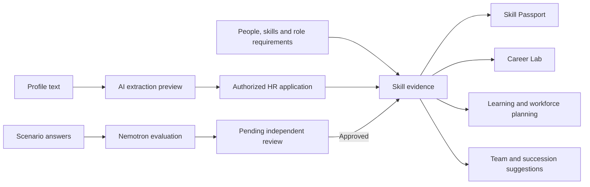

# SkillGraph

### See what your people can do. Help them do what comes next.

**SkillGraph is an AI-assisted skill intelligence platform that connects practical assessments, career development, and workforce planning.** It helps employees understand their next step and gives HR the evidence to support it.

Imagine a company about to launch an AI project. It has hundreds of employees, a limited training budget, and a simple question: *do we already have the people to deliver this?*

The answer is usually scattered across résumés, spreadsheets, manager feedback, and course records. A job title tells part of the story. A completed course tells another. Neither shows the whole picture of what someone can demonstrate today or what they could become with the right support.

SkillGraph brings that picture together. People demonstrate skills through work scenarios. A human reviews the AI's evaluation. Those skills then inform career simulations, learning plans, team suggestions, and succession planning.

> **Our pitch:** Make potential visible, make development actionable, and give every workforce recommendation a reason someone can inspect.

**Built with:** NVIDIA Nemotron 550B · FastAPI · SQLite · an interactive browser interface

[Get started](#get-started) · [Standout features](#the-features-that-make-the-demo-worth-watching) · [Five-minute demo](#a-five-minute-demo-for-judges) · [How it works](#how-it-works) · [User profiles](#user-profiles-and-access) · [Troubleshooting](#troubleshooting) · [Operations](#security-and-operations)

## The problem we are solving

| Person | The question | What SkillGraph helps them do |
|---|---|---|
| Employee | “What would it take for me to move into this role?” | See specific gaps, test a development scenario, and demonstrate progress. |
| Manager | “Who could help us deliver this project?” | Find people whose skills complement one another within their department. |
| HR or learning lead | “Where should our limited training time go?” | Compare skill demand with supply and explore a capacity-aware learning plan. |
| Workforce planner | “Where are we exposed if a key person leaves?” | Inspect critical-role successor benches and skills held by very few people. |

The product connects these questions through shared skill evidence. An assessment becomes the beginning of a development conversation, with practical uses beyond the score itself.

## The features that make the demo worth watching

### 1. Career Lab: try a future before committing to it

Choose a person and a target role. Adjust skill levels and watch projected role coverage, learning hours, and estimated weeks change.

Someone interested in becoming a Data Scientist can explore how improving SQL or Machine Learning changes their readiness. HR can use the same view to discuss a development plan. Eligible mentor suggestions help managers and HR identify internal support within their access scope.

**The demo moment:** move a skill slider and show exactly which part of the role gap it closes. The employee's official record stays untouched by the simulation.

The view also includes an evidence-adjusted score, helping distinguish recorded proficiency from proficiency supported by stronger, fresher evidence. Employee access does not expose colleagues' private profiles.

### 2. Skill Passport: a skill record with a story behind it

A skill rating is more useful when you can ask, “Where did this come from?”

The passport brings together proficiency, source, recorded confidence, evidence summaries or quotes where available, and the age of the evidence. It flags weaker or older signals for review.

**The demo moment:** show similar skill levels with different evidence strength. Explain why an older claim might deserve a fresh assessment before a major staffing decision.

The passport is an internal evidence view. Its strength indicator is an explainable heuristic, not a verified credential or a probability that someone will succeed.

### 3. AI assessment with an independent human decision

Nemotron generates four practical scenarios, moving from basic application to expert judgment. Employees explain their approach and tradeoffs. AI evaluates correctness, reasoning, practical tradeoffs, and clarity, then proposes a level with feedback.

That proposal enters **Review center**. A different authorized reviewer examines the answers, accepts or adjusts the proposed level, or rejects it with a reason. Approval updates proficiency, assessment history, role readiness, and the approval audit event together.

**The demo moment:** submit an assessment, show that official proficiency has not changed, then approve it from an HR account and inspect the resulting record.

The system blocks self-review, repeat decisions, and approval of an evaluation whose underlying rating has changed. AI results are matched to the question's difficulty level, so a reordered response does not silently attach scores to the wrong question.

### 4. Investment Lab: give the learning budget a concrete purpose

Set a training-hours budget, planning period, weekly learning time, and demand scenario. SkillGraph suggests development actions that address skill shortages while respecting each person's modeled learning capacity and availability.

For example: *with 200 learning hours over eight weeks, which existing learners could move toward independent proficiency in skills we need?*

**The demo moment:** increase demand or reduce the budget and compare proposed actions, hours used, people supported, and remaining shortfall.

Each action explains the gap it addresses. Selection uses a lowest-hours-first heuristic, with budgets measured in hours rather than money. Learning outcomes remain hypothetical until assessed.

### 5. Team Studio: build a team whose strengths fit together

Choose a project, team size, and minimum availability. SkillGraph selects people based on the additional skill coverage they bring to the team already selected.

A project needing machine learning, security, and cloud architecture can benefit from people with different strengths. Each suggested member comes with their contribution and the coverage they add. Remaining gaps stay visible.

**The demo moment:** open the seeded **Responsible AI Launch** project and explain why each person earns a place on the suggested team.

This is a complementary-skill recommendation. It does not book people's time or reserve capacity across projects.

### 6. Succession and continuity: see where the bench is thin

Mark important roles as critical and inspect the people classified as ready now, ready soon, or developing. Continuity analysis also highlights important skills with few proficient holders.

**The demo moment:** identify a thin successor bench, then open a development conversation around the relevant skill gaps.

These are rule-based planning indicators derived from recorded skills and role requirements. They do not predict resignations or guarantee that a person can take over a role.

### 7. Turn existing experience into a starting point

Through workspace management, paste résumé, profile, or project-description text to preview suggested skills from the existing catalog. Accepted suggestions must include an exact supporting quote from the submitted text.

HR or an administrator can apply extracted ratings; protected assessed or human-reviewed ratings are retained. Gap-based development plans connect role requirements with catalog learning resources, with optional AI coaching to explain practice and verification steps.

**The demo moment:** turn a short project description into inspectable skill suggestions, then explain how assessment and review can strengthen that initial evidence.

## Why this is a compelling hackathon project

The standout idea is the connection between individual growth and organizational decisions. The same evidence can help an employee explore a career, help a manager assemble a team, and help HR decide where learning effort matters most.

Three design choices make that story tangible:

- **Interactive decisions:** judges can change a skill, learning budget, or team constraint and see the consequences in the product.
- **Inspectable recommendations:** the app exposes gaps, supporting evidence, assumptions, and individual team contributions.
- **Human accountability:** AI assists with interpretation and assessment; an independent reviewer controls whether an assessment changes official proficiency.

The prototype demonstrates this journey with synthetic data. Business value can then be tested in a pilot by measuring time to prepare development plans, agreement between AI and reviewers, team-planning effort, and reassessed skill-gap closure. These are proposed evaluation measures, not claimed results.

## How it works



**AI handles language-heavy work:** generating scenarios, evaluating written answers, identifying supported skills in text, and writing optional coaching guidance.

**Application code handles planning calculations:** role coverage, learning estimates, evidence freshness, budget allocation, and complementary team selection. These calculations remain available without an AI key.

**People provide context and decisions:** HR maintains requirements, employees contribute evidence, and eligible reviewers decide whether assessment proposals should become official ratings.

### What the numbers mean

| Measure | Plain-language meaning |
|---|---|
| Proficiency level | A 0–5 skill scale. Level 1 represents awareness; levels 2–5 progress from basic application through independent delivery, design, and expert judgment. Zero means no demonstrated level in the assessment or no recorded coverage in planning. |
| Assessment result | Four questions at levels 2–5. Each successive level requires at least 70% on its question. The overall score is weighted by question difficulty. |
| Role readiness | Weighted coverage of required skill levels, capped at each requirement. For two equally weighted L4 requirements, recorded levels of L4 and L2 give 75% coverage. This is not a 75% chance of job success. |
| Evidence strength | Recorded confidence multiplied by freshness. Freshness declines over 730 days, with a 25% floor. AI assessment confidence is capped at 85%; it is not statistically calibrated. |
| Learning estimate | Career and investment scenarios use 25 hours per level. Development plans use catalog resource hours where available. These are planning assumptions. |
| Skill slot addressed | One person moving toward the target level in one demanded skill. A person may address several slots; slots are not hires avoided. |

Missing evidence counts as zero coverage for planning. It should prompt a conversation or assessment, not an assumption that someone lacks the ability.

## Get started

This guide uses the virtual environment's Python executable directly. **No PowerShell scripts, activation scripts, Docker, PostgreSQL, or separate frontend build are required.** The Windows commands work in Command Prompt or PowerShell; the macOS/Linux commands work in a normal terminal.

### 1. Check the prerequisites and open the project folder

Install Python 3.12 or newer with `pip` and `venv` available. Internet access is needed to install dependencies and call NVIDIA. The planning features can run locally after installation.

Download or clone the project, then open a terminal in the folder containing `README.md`, `requirements.txt`, `app`, and `scripts`. On the original development machine, that folder is `C:\Users\sujit\skillgraph-api-2`; on another machine, use the location where you saved it.

On Windows, check Python:

```text
py -3 --version
```

If the `py` launcher is unavailable but Python is on your PATH, use `python --version` and `python -m venv .venv` in the next step. Confirm that the reported version is at least 3.12.

On macOS or Linux:

```bash
python3 --version
```

Run every command below from the project root. Relative database paths are resolved from the working directory, so starting from another folder can accidentally select a different database.

### 2. Create the environment and install dependencies

**Windows — Command Prompt or PowerShell:**

```text
py -3 -m venv .venv
.\.venv\Scripts\python.exe -m pip install -r requirements.txt
```

**macOS / Linux:**

```bash
python3 -m venv .venv
./.venv/bin/python -m pip install -r requirements.txt
```

If Linux reports that `venv` or `ensurepip` is unavailable, install your distribution's matching Python venv package and retry environment creation. There is no need to change PowerShell execution policy because these instructions run an executable directly.

### 3. Create the local configuration

In your editor, create a file named exactly `.env` beside `requirements.txt`. On Windows, make sure it has not been saved as `.env.txt`. If `.env` already exists, update it rather than replacing a working configuration.

```dotenv
DATABASE_URL=sqlite:///./dev.db
NVIDIA_API_KEY=
NVIDIA_MODEL=nvidia/nemotron-3-ultra-550b-a55b
APP_ENV=development
```

| Setting | What to enter |
|---|---|
| `DATABASE_URL` | `sqlite:///./dev.db` stores the local database in the project root. The file is created automatically when the database is initialized. Its parent directory must exist and be writable. |
| `NVIDIA_API_KEY` | Paste your own NVIDIA API key after `=` to enable AI. Leave it empty for planning-only use. Never commit the key or include it in a screenshot. |
| `NVIDIA_MODEL` | The configured Nemotron model identifier shown above. Access depends on your NVIDIA account and provider availability. |
| `APP_ENV` | Use `development` for local HTTP testing. The HTTPS deployment settings are explained under Security and operations. |
| `APP_ORIGIN` | Not needed for normal localhost development. Required as the public HTTPS origin when using production mode. |

The key stays on the server. Relevant assessment answers, profile text, or coaching context are sent to NVIDIA when those features are used. The application does not require a separate OpenAI key. The old shared `API_KEY` setting does not authenticate users; everyone signs in through an individual account.

Existing operating-system environment variables take precedence over `.env`. If a changed setting does not take effect, check for an older exported value in the terminal, IDE launch configuration, or service configuration. Stop and restart the server after editing `.env`.

### 4. Choose demo data or an empty workspace

**Option A — hackathon demo:** seed a fresh, empty database.

Windows:

```text
.\.venv\Scripts\python.exe -m scripts.demo
```

macOS / Linux:

```bash
./.venv/bin/python -m scripts.demo
```

This loads **420 synthetic people, 16 skills, six roles, four projects, and 64 illustrative learning resources**. People and ratings are synthetic, and course links are placeholders rather than live provider integrations. Demo employee records are not login accounts.

Run this only once on an empty database. If seeding reports that data already exists, continue with your existing workspace. To prepare a separate demo, choose a new SQLite filename in `.env` and restart the setup steps for that database; preserve the existing database.

**Option B — start with your own records:** skip demo seeding. Create the administrator below, start the server, and use **Manage workspace** to add skills, roles and requirements, employee records, learning resources, and projects. Add employee records before creating linked employee accounts or department-scoped manager accounts.

### 5. Create the first administrator

Windows:

```text
.\.venv\Scripts\python.exe -m scripts.bootstrap_admin
```

macOS / Linux:

```bash
./.venv/bin/python -m scripts.bootstrap_admin
```

Enter an administrator username, a password, and the password again. Password entry may show no characters; this is normal. Usernames accept 3–100 letters, numbers, or the characters `_ . @ -`; usernames are stored in lowercase. Passwords must contain 15–256 characters.

**There are no shipped default usernames or passwords.** Use the credentials you create here. If the command says accounts already exist, sign in using an existing administrator and manage accounts in the UI. The bootstrap command is for the first account, not password recovery or repeated account creation.

### 6. Start the application

Windows:

```text
.\.venv\Scripts\python.exe -m uvicorn app.main:app --host 127.0.0.1 --port 8000
```

macOS / Linux:

```bash
./.venv/bin/python -m uvicorn app.main:app --host 127.0.0.1 --port 8000
```

Keep the terminal open. Once it reports that Uvicorn is running, open **http://127.0.0.1:8000/** and sign in. The same server serves the browser interface and API; there is no second frontend command.

To use port 8018, change `--port 8000` to `--port 8018` and open **http://127.0.0.1:8018/**. Use the port shown by your terminal. Binding to `127.0.0.1` makes this a local-machine session.

### 7. Stop, restart, and confirm that it works

Press **Ctrl+C** in the server terminal to stop gracefully. To restart later, open a terminal in the same project root and run only the server command from step 6. Do not repeat demo seeding or initial administrator setup. Records and accounts persist in the SQLite database selected by `DATABASE_URL`.

Open **http://127.0.0.1:8000/health** to check that the server and database respond; a successful response is `{"ok":true}`. Substitute your chosen port. After signing in, **My account** shows the configured AI model. A configured key indicates configuration presence, not proof that the provider is currently accepting requests; complete an assessment to test live AI.

## User profiles and access

There are two different meanings of “profile” in this application:

- An **employee record** describes a person: name, external employee ID, department, title, current career role, availability, and recorded skills.
- A **login account** controls access: username, password, one access role, active status, and any linked employee record or manager department scope.

Creating an employee record does not create a login. A career role such as Data Scientist describes required skills; an access role such as HR controls permissions. These are separate concepts.

### Administrator

The first administrator is created through the Python command above. Administrators manage accounts and have organization-wide planning and record access. Open **Access management** to create users, change their access, disable accounts, or reset another user's password. Use **My account** to change your own password.

### HR

HR sees the organization-wide Overview, Career Lab, Skill Passport, Investment Lab, Team Studio, AI Assessment, Review center, and Governance. HR can manage workforce records, apply extracted skill suggestions, and export reports, but cannot manage login accounts.

### Manager

A manager must have an exact existing department scope, such as `Product`. Their people, mentor suggestions, staffing candidates, team recommendations, and review access are restricted to that department. Managers can use Career Lab, Skill Passport, Team Studio, AI Assessment, and Review center. They do not have organization-wide investment, audit, import, or account-management access.

### Employee

An employee account must link to an existing employee record. Employees can explore their own Career Lab and Skill Passport, submit their own assessments, and follow their own review status. They cannot browse coworkers' records or approve assessments.

### Create accounts for a demo or pilot

1. Sign in as administrator and open **Access management**.
2. Enter a unique username and an initial password of at least 15 characters.
3. Select **Employee**, **Manager**, **HR**, or **Admin**.
4. For an employee, search for the person and select their linked employee record. For a manager, enter an exact existing department name. A linked record is optional for HR/admin and managers, but any supplied record must exist.
5. Create the account and share its credentials privately with its owner.
6. Sign out and sign in with that account to verify the intended workspace. Use separate browser profiles for simultaneous roles; tabs in the same browser profile share login cookies, including localhost tabs on different ports.

Each employee record can be linked to only one account. Changing access, disabling an account, or changing/resetting a password revokes existing sessions; the affected user must sign in again.

Example account arrangement for a newly seeded demo:

| Suggested username | Access role | Employee link | Department scope |
|---|---|---|---|
| `demo.admin` | Admin | Optional | Not required |
| `demo.hr` | HR | Optional | Not required |
| `demo.manager` | Manager | Optional | `Product` |
| `demo.employee` | Employee | Select the existing `E0001` employee record | Not required |

These names are suggestions to create yourself, not preconfigured credentials. Choose a separate password for each account. The seeded departments are `Platform`, `Data & AI`, `Security`, `Product`, and `Cloud Ops`. Use the employee picker to distinguish the external ID, such as `E0001`, from the internal numeric record ID.

### Full permission matrix


| Capability | Administrator | HR | Manager | Employee |
|---|---|---|---|---|
| Manage accounts, roles, active status, password resets | Yes | No | No | No |
| Read employee records and passports | All | All | Own department | Self |
| Career simulation | All | All | Own department | Self |
| Submit assessments | All | All | Own department | Self |
| Review an assessment | All | All | Own department | No |
| Manual ratings and workforce imports | Yes | Yes | No | No |
| Team/candidate matching | All | All | Own department | No |
| Organization analytics, investment, succession | Yes | Yes | No | No |
| Download workforce CSV reports | Yes | Yes | No | No |
| Read audit events | Yes | Yes | No | No |
| Read skill/role/learning catalogs | Yes | Yes | Yes | Yes |

A reviewer cannot approve or reject their own submission or their own employee assessment. HR and administrators have organization-wide access; this installation represents **one organization**. Managers need an exact existing department scope. Employee accounts must link to an employee record. Linked employee IDs are unique across accounts.

The backend enforces access on individual-record endpoints, list queries, career simulation input IDs, candidate lists, mentor suggestions, project staffing, and team selection. Changing a URL or showing a hidden button does not grant access. Unknown API handlers are denied unless explicitly registered in the access policy.

## Test the complete assessment journey

1. Sign in as the employee account and open **AI assessment**. Select a skill and prepare its questions. Previously generated questions may be reused from the cache.
2. Answer all four scenarios and submit. The AI returns feedback, a score, and a proposed proficiency level. Allow up to 90 seconds for the provider call.
3. Open **Review center** and confirm the evaluation is pending. Check the **Skill Passport**: official proficiency must still reflect the previous record.
4. Sign out, then sign in as a different HR account. Open **Review center**, inspect the answers and feedback, and approve, adjust, or reject with a meaningful rationale of at least 10 characters.
5. After approval, inspect the person's Skill Passport and role readiness. Open **Governance** to see the recorded approval and reviewer.
6. Sign back in as the employee to see the approved result. A rejected evaluation leaves official proficiency unchanged.

A person cannot review their own submission or their own employee assessment, even with administrator access. Only one pending evaluation per employee/skill is allowed. If the underlying rating changes while a review is pending, reject the stale evaluation and submit a fresh assessment. A completed review cannot be replayed.

## A five-minute demo for judges

Prepare the demo database and accounts beforehand. Test the AI provider before presenting and allow extra time for live calls. Keep a clearly labeled previous evaluation available to inspect if the provider is busy.

| Time | Show | Explain |
|---|---|---|
| 0:00–0:30 | Overview | “We have a new initiative and a limited learning budget. Let's find the capability already inside the organization.” |
| 0:30–1:20 | Career Lab | Select a person and target role. Move a skill slider. “This makes development specific: which gap, how much estimated effort, and what changes?” |
| 1:20–1:55 | Skill Passport | Inspect source and freshness. “Before trusting a score, we can examine the evidence behind it.” |
| 1:55–2:50 | AI Assessment and Review center | Show a prepared submission and review it from a different account. “AI proposes. A person checks the evidence and owns the decision.” |
| 2:50–3:40 | Investment Lab | Change the budget or demand scenario. “Now connect individual growth to the skills the organization needs.” |
| 3:40–4:30 | Team Studio | Build a team for Responsible AI Launch. Show each member's contribution and remaining gaps. |
| 4:30–5:00 | Governance | Inspect the recorded decision. “From demonstrated skill to a development plan to a stronger team, with reasons we can inspect.” |

For a live assessment, let the participant answer honestly and show the actual outcome. Introduce previously prepared evaluations as prepared evidence. Seeded ratings are illustrative data, not measured employee outcomes.

## Engineering behind the experience

```text
Browser studio and workspace management
                  |
FastAPI: authentication, access checks, input validation
                  |
        +---------+----------+
        |                    |
Planning and review     Bounded NVIDIA gateway
services                Scenarios, evaluation,
        |               extraction, coaching
SQLAlchemy + SQLite
People, skills, ratings, readiness,
sessions, reviews and audit events
```

- **Clear responsibilities:** AI interpretation, planning calculations, authorization, and persistence have separate modules.
- **Consistent updates:** approval and its rating, history, readiness, and audit changes share a database transaction. Stale and repeated approvals are rejected.
- **Validated AI output:** schema checks reject malformed responses. Grading checks difficulty identifiers and forces blank answers to score zero.
- **Bounded provider use:** cached questions, one in-flight AI call per process, a 90-second timeout, and a 60-second cooldown after rate limiting.
- **Protected access:** individual accounts, hashed passwords, expiring server-side sessions, CSRF protection, login throttling, and scoped APIs. Access changes revoke existing sessions.
- **Practical persistence:** SQLite uses WAL, foreign-key enforcement, a busy timeout, and an online backup utility. CSV reporting covers skill matrices, readiness, workforce plans, and succession.

The pilot runs with one Uvicorn worker. SQLite serializes writes, and the AI concurrency gate is process-local. A deployment for substantially larger or more concurrent workloads requires measurement and further engineering.

### Finding your way around the code

| Location | Responsibility |
|---|---|
| `app/static/` | Browser studio, login, and workspace management |
| `app/main.py` | Core APIs, records, assessments, reports, and app setup |
| `app/intelligence.py` | Career scenarios, passports, investment planning, and team selection |
| `app/ai.py` / `app/llm.py` | AI prompts, response validation, and NVIDIA calls |
| `app/security.py` / `app/security_models.py` | Access policy, accounts, sessions, reviews, and audit models |
| `app/governance.py` | Independent review decisions and governance APIs |
| `app/models.py` / `app/db.py` / `app/readiness.py` | Domain data, SQLite configuration, and readiness calculations |
| `scripts/` | Demo data, initial administrator setup, and backups |
| `tests/` | API, intelligence, security, and reliability checks |

## Testing and operating the pilot

Run the regression suite from the project root.

Windows:

```text
.\.venv\Scripts\python.exe -m pytest -q
```

macOS / Linux:

```bash
./.venv/bin/python -m pytest -q
```

The latest recorded local run passed **46 tests**. Tests use temporary SQLite data and mocked AI responses, with live credentials explicitly disabled. Coverage includes access boundaries, sessions, CSRF, review conflicts and rollback, planning constraints, exports, backups, and reordered AI grading responses. Existing dependency and datetime deprecation warnings remain.

Live NVIDIA question generation, grading, and the review-to-rating flow have also been exercised with synthetic data. An ordering issue found during that test was fixed and regression-tested; the immediate live retest was blocked by provider overload. Provider availability and output quality still need checking for each demonstration or pilot.

If AI is unavailable, planning views remain usable. Check configuration and access for key-related errors, and allow the provider time to recover from overload or rate limits. A failed AI request does not save a new assessment result.

Administrator-only API schema is available at `/api-schema`. Public Swagger/ReDoc pages are disabled. Reading cached questions uses GET; generating questions uses a CSRF-protected POST. The access matrix above and the operations guidance below cover setup and maintenance in this README.

## Troubleshooting

| Symptom | What to check |
|---|---|
| `py`, `python`, or `python3` is not recognized | Install Python 3.12+ and reopen the terminal. On Windows, try the installed `python` command if `py` is unavailable. |
| PowerShell says scripts are disabled | Use the direct `.venv` Python executable commands above. No activation or execution-policy change is needed. |
| `No module named uvicorn`, `fastapi`, or `sqlalchemy` | Install `requirements.txt` using the same `.venv` Python executable used to start the server. |
| `No module named app` or `scripts` | Open the terminal in the project root, not inside `app`, `scripts`, or another directory. |
| Port already in use | Choose an unused port, such as `8018`, and open that port in the browser. |
| Empty workspace or missing login after restarting | Confirm the working directory and `DATABASE_URL`. A different relative path or exported environment variable may select another database. |
| Demo data already exists | Skip seeding. Preserve your existing records; use a separate new database file for a fresh demo. |
| Accounts already exist | Use an existing administrator account. Bootstrap intentionally refuses to create another first administrator. |
| Cannot create a manager or employee account | Check the exact existing department name, employee link, and whether that employee record is already linked to another account. |
| Login suddenly expires | Sessions expire after eight hours and are revoked after access or password changes. Sign in again. |
| Too many login attempts | Wait for the 15-minute throttle window. Successful attempts also count toward the limit. |
| NVIDIA is not configured | Set `NVIDIA_API_KEY` in `.env`, check for an overriding environment variable, and restart the server. |
| NVIDIA rejects access | Check the key and the configured model's availability to your account. Do not paste the key into logs or support messages. |
| AI is busy, rate-limited, overloaded, or timed out | Wait before retrying. Only one AI call runs at a time per process; rate limits trigger a 60-second cooldown. Planning tools remain usable. |
| AI response validation failed | No assessment result was saved. Retry later; output must contain a valid result for every difficulty level. |
| Review button is unavailable | Check account role, department scope, whether you submitted the evaluation, whether it concerns your own employee record, and whether it has already been reviewed. |
| Rating changed since submission | The review is stale. Reject it and reassess against the current record. |
| SQLite cannot open the database | Check that the configured parent folder exists and the application user can write to it. |
| SQLite is locked | Use one server worker, avoid multiple running instances writing to the same file, and check for other tools holding a write transaction. |
| Production startup fails or cookies do not work over local HTTP | Use `APP_ENV=development` locally. Production requires an HTTPS origin and Secure cookies. |

## Security and operations

### Sessions and account protection


- Salted PBKDF2-HMAC-SHA256 password hashes (600,000 iterations).
- Opaque random session cookies; only a SHA-256 digest of the session identifier is stored in SQLite.
- HttpOnly and SameSite=Strict cookies; Secure cookies and HSTS when `APP_ENV=production`.
- Eight-hour absolute session expiry, server-side logout, and immediate session revocation after access changes, disabling an account, or changing/resetting a password.
- CSRF tokens for state-changing authenticated requests plus origin checks. Tokens are held in browser memory, not local storage.
- Login throttling is persisted in SQLite: at most 20 attempts per account or source address in a 15-minute window. Both successful and failed attempts count.
- Trusted-host validation, no-store responses, frame protection, and a content security policy. The legacy HR management page still requires an inline-script exception; the new studio/login pages do not.

There is no production bypass or unauthenticated demo mode. The first administrator is created locally using the CLI. Account access changes and password resets are available through administrator-only APIs. The UI supports account creation, access changes, disabling accounts, administrator password resets, and self-service password changes.

The legacy shared API key is not a login method. Unknown API handlers are denied unless registered in the access policy. The installation represents one organization; department scoping is not tenant isolation.

### Review records and audit history

Governance shows pending reviews, completed evaluations, active accounts, reviewed ratings, and paginated audit activity. Account and approval events are recorded transactionally. General mutation and report-request audit events are recorded after the request handler returns.

Audit logs exclude credentials, session tokens, and raw request bodies. The restricted review table intentionally retains submitted answers and AI feedback so a reviewer can inspect the decision. The local audit database is not tamper-proof against a database administrator; retention and external durable audit storage require further deployment work.

Manual rating APIs cannot claim reserved human-review or AI-assessment provenance. Profile extraction previews only catalog skills with supporting quotes, and applying extraction cannot overwrite protected assessed or human-reviewed ratings. CSV exports neutralize formula-like cell values, including leading-whitespace variants.

### Database location and backups

`DATABASE_URL=sqlite:///./dev.db` uses `dev.db` in the working directory. SQLite also creates `-wal` and `-shm` sidecar files during operation. Use a writable local disk for this pilot. WAL, foreign-key enforcement, and a 15-second busy timeout are enabled. Keep one Uvicorn worker; writes serialize and the AI gate is process-local.

Existing tables are not retroactively migrated or repaired by `create_all`. The security tables are additive, but this does not replace versioned migrations. Back up before updating an existing installation.

Create a consistent online backup from the project root in a second terminal while the app is running, or after stopping it:

Windows:

```text
.\.venv\Scripts\python.exe -m scripts.backup backups/skillgraph-before-update.db
```

macOS / Linux:

```bash
./.venv/bin/python -m scripts.backup backups/skillgraph-before-update.db
```

Use a new filename for each backup. The utility creates the destination directory when needed, refuses to overwrite an existing file, includes committed WAL data through SQLite's backup API, and checks database integrity. Restrict access to backups because they contain workforce records, submitted evidence, and password hashes.

### Restore safely into a separate database

1. Stop the server with Ctrl+C. Preserve the current database and any remaining sidecar files together.
2. Copy a verified backup to a separate filename, such as `restored.db`, without overwriting the current database. A normal file-manager copy is sufficient for the verified backup file.
3. Update `.env` to `DATABASE_URL=sqlite:///./restored.db`. Check that an exported environment variable does not override it.
4. Run the normal server command. Do not reseed or bootstrap accounts against the restored database.
5. Check `/health`, sign in with an account from the backup, and inspect employee records, ratings, reviews, and audit history. Data created after the backup will not be present.
6. If the restore is unsuitable, stop the server and point configuration back to the preserved original database before restarting.

Exercise restoration on a separate pilot instance before relying on a backup procedure.

### Local development and HTTPS deployment profiles

| Runtime profile | Settings | Intended use |
|---|---|---|
| Local development | `APP_ENV=development`; localhost HTTP; no `APP_ORIGIN` needed | Personal testing and the hackathon demo. |
| HTTPS deployment | `APP_ENV=production`; `APP_ORIGIN` set to the real public HTTPS origin | A controlled deployment behind a correctly configured TLS reverse proxy. |

For an HTTPS deployment, change these values in `.env`:

```dotenv
APP_ENV=production
APP_ORIGIN=https://your-actual-skillgraph-host.example
```

Replace the example hostname with your own. Production startup fails without an HTTPS origin. This setting enables Secure cookies and HSTS; it does not create a TLS certificate or configure a proxy. Terminate TLS at your trusted reverse proxy, keep the application port private, and trust forwarded headers only from that proxy. Configure DNS, certificates, and service startup for your deployment environment. Do not use development mode as a substitute for HTTPS on a public service.

### Before widening access

Start with synthetic data, then a limited approved employee cohort in one organization. Assign individual accounts, verify department boundaries, review AI recommendations, exercise backup/restore, and measure response times and agreement with human reviewers.

Broader production rollout still needs SSO/MFA and identity lifecycle integration, a password-recovery policy, approval for sending employee text to NVIDIA, retention/deletion and backup-access rules, external durable audit storage, formal migrations, realistic concurrency/load testing, monitoring and incident procedures, review of the legacy management UI, and benchmarked assessment quality. Multiple organizations require explicit tenant isolation. Cross-project capacity reservation and fairness/validity studies are not implemented.

## Where we take it next

The current implementation supports a **single-organization, controlled pilot**. The following are roadmap items, not shipped capabilities:

| Next step | Value it would add |
|---|---|
| Work-evidence integrations | Bring approved evidence from project and learning systems into the passport with explicit provenance and consent. |
| Assessment calibration | Compare AI evaluations with expert reviewers across skills and populations; improve rubrics using measured agreement. |
| Learning outcome tracking | Compare planned development with reassessed progress and actual learning effort. |
| Cross-project capacity planning | Reserve and reconcile staffing commitments across competing initiatives. |
| Enterprise identity and operations | Add SSO/MFA, identity lifecycle integration, versioned migrations, monitoring, external durable audit storage, and retention controls. |

Before broader deployment, complete realistic load testing, restore exercises, assessment-quality evaluation, and organizational approval for processing employee text with the AI provider. Multi-organization hosting requires explicit tenant isolation. The current audit table is useful for inspection but is not tamper-proof against a database administrator.

The ambition is straightforward: give people a clearer path to their next opportunity, and help organizations support that path with evidence they can understand.
