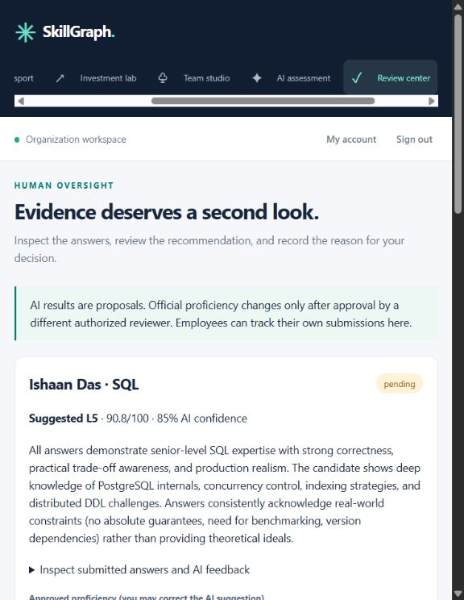
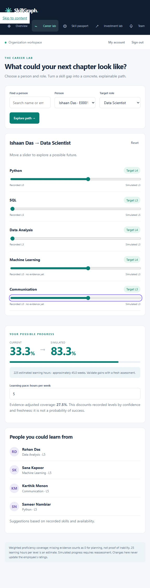
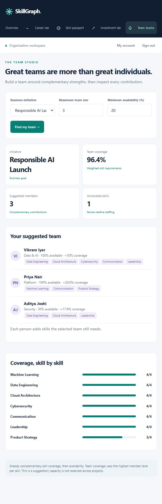

# SkillGraph
## From demonstrated skills to smarter workforce decisions

SkillGraph helps employees understand their development opportunities and helps HR decide where to invest learning effort and how to assemble project teams. It connects practical AI assessments, skill evidence, career scenarios, and workforce planning in one application.

The demonstration uses **420 synthetic people, 16 skills, and six career roles**. Screenshots come from the running application. The SQL evaluation below is a fresh NVIDIA Nemotron result obtained on **9 October 2026**, using prepared demonstration answers.

## 1. Practical AI assessment with human accountability

Employees respond to four work scenarios, progressing from basic application to expert judgment. Nemotron evaluates correctness, reasoning, practical tradeoffs, and clarity, then returns feedback and a proposed proficiency level.

The live SQL demonstration produced:

| Difficulty | Score |
|---|---|
| Level 2 | 92/100 |
| Level 3 | 95/100 |
| Level 4 | 88/100 |
| Level 5 | 90/100 |

The weighted score was **90.8/100**, with a proposed **L5** and displayed AI confidence of **85%**. Feedback identified improvements such as quantifying index tradeoffs and addressing transaction isolation.

The result remains **pending independent review**. Official proficiency has not changed. An eligible reviewer can inspect the answers, correct the proposed level, approve, or reject with a rationale. Self-review is blocked.

**Why it matters:** the assessment produces inspectable evidence and useful feedback, while a person retains responsibility for updating the official record. AI confidence is not a calibrated probability of job success.

## 2. Career Lab: explore a development path

Career Lab makes role gaps understandable through interactive skill scenarios. In the captured Data Scientist example, Ishaan Das has **33.3% recorded skill coverage**. Simulating Python, Machine Learning, and Communication at L3 raises projected coverage to **83.3%**.

The scenario estimates **225 learning hours**, or **45 weeks at five hours per week**, and surfaces eligible internal mentor suggestions within the viewer's access scope.

**Why it matters:** development discussions become specific—what to improve, how much effort is assumed, and how that changes role coverage. Simulations leave official records untouched. Learning estimates use 25 hours per level and require reassessment to verify progress.

## 3. Investment Lab: connect training effort to workforce gaps

HR can adjust learning budget, planning horizon, weekly learning time, and future demand. The application proposes named development actions constrained by modeled availability and learning capacity.

In the eight-week demonstration at five hours per person per week:

| Learning budget | Proposed skill slots addressed | People supported |
|---|---|---|
| 200 hours | 8 | 8 |
| 400 hours | 16 | 16 |

**Why it matters:** a training budget becomes a concrete allocation of effort toward needed capabilities. Each slot is one person–skill pair. These are projected actions selected by a lowest-hours-first heuristic, not completed learning or hiring savings.

## 4. Team Studio: combine strengths and explain every contribution

For **Responsible AI Launch**, the application recommends three complementary members with **96.4% weighted skill coverage**:

| Person | Added coverage |
|---|---|
| Vikram Iyer | 50% |
| Priya Nair | 28.6% |
| Aditya Joshi | 17.9% |

Their combined contributions cover machine learning, data engineering, cloud architecture, security, communication, and leadership. Product Strategy remains visibly below its target: **L3 against an L4 requirement**.

**Why it matters:** the recommendation explains what each person adds and what the team still lacks. Coverage is a planning measure, not a probability of project success; the suggestion does not reserve capacity across projects.

## 5. Evidence and access that make decisions inspectable

**Skill Passport** shows recorded proficiency alongside source, confidence, freshness, and available evidence. It helps distinguish a skill level from the strength of the signal supporting it. Evidence strength is an explainable confidence-and-freshness heuristic.

**Governance** records review activity and changes. Approved assessments update rating, history, readiness, and the approval audit event together. Stale or repeated approval attempts are rejected.

**Access profiles** give administrators account management, HR organization-wide oversight, managers their department, and employees their own records. Those boundaries are enforced by the backend.

## The connected value

A demonstrated skill can inform a career conversation, a learning allocation, and a complementary project team. SkillGraph brings these decisions together with interactive scenarios, inspectable evidence, and independent review.

This is a working single-organization pilot. Real-world impact and assessment quality still need measurement in an approved deployment.
